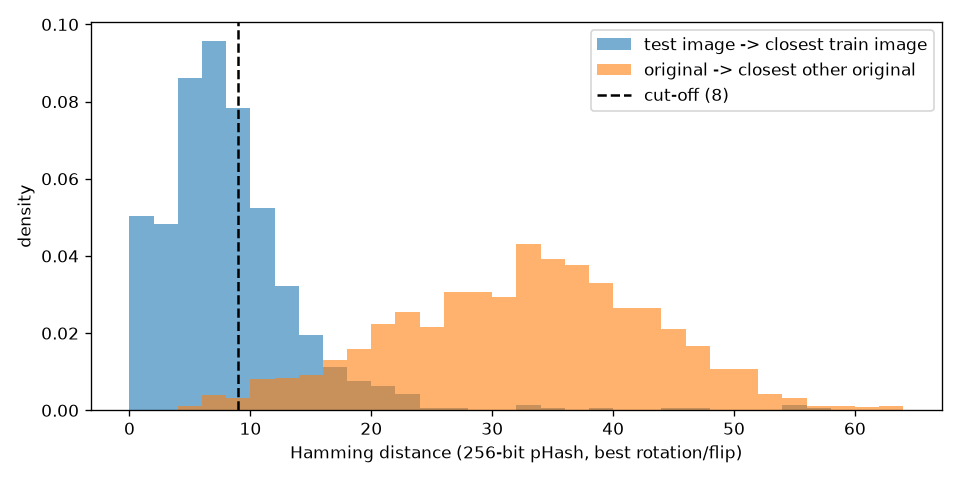

# Data Card

## Source

- Real-life Industrial Dataset of Casting Product, Kaggle (ravirajsinh45).
- Top-view photos of submersible pump impellers from a casting foundry in Rajkot, Gujarat.
- License: Attribution-NonCommercial-NoDerivatives 4.0 International (CC BY-NC-ND 4.0)

## Contents

Two versions are included:

- casting_data: 300×300 images, already split into train and test. Augmented, and the split leaks (see below). Only used for the leakage check now.
- casting_512x512: 1300 original 512×512 images (781 defective, 519 OK), no augmentation. Used for training and evaluation.

## Class counts (300×300 set)

| Split | Defective | OK   | Total | % defective |
| ----- | --------- | ---- | ----- | ----------- |
| Train | 3758      | 2875 | 6633  | 56.7%       |
| Test  | 453       | 262  | 715   | 63.4%       |
| Total | 4211      | 3137 | 7348  | 57.3%       |

A real production line has far fewer defects, so precision measured here would look better than it would on the line.

## Image format

- 300×300 set: 7348 JPEGs. 512×512 set: 1300 JPEGs.
- Both stored as RGB, but all three channels are identical, so they are really grayscale.
- I keep 3 channels as model input because pretrained models expect them.
- No corrupted files found.

## Observations

- Mean brightness, 300×300 set: defective 139.3, OK 149.8 (pixel values 0 to 255). 512×512 originals: defective 138.6, OK 149.0.
- Brightness alone (darker = defective) gives ROC-AUC 0.876 on the 300×300 set and 0.801 on the originals. That's a lot of signal from something that isn't a defect, so the model could learn darkness as a shortcut. Checked later with a lighting stress test, no sign it did (see reports/evaluation.md).
- Defect types I've seen while going through the images: flash and burrs along the outer rim, blowholes and pinholes on the flat face, cracks and chipped edges, and rough or uneven patches. Most of them are on or near the rim.
- Some defects are tiny, a few pixels at 224×224. A couple of defective images I couldn't find the defect in at all, so there may be some label noise.

## Suspicious findings

- The Kaggle page says augmentation was already applied to the 300×300 images. 1300 originals turned into 7348 images, so each part shows up about 5-6 times, rotated, flipped or zoomed.
- 37 defective test images are named `new__0_*` instead of `cast_def_0_*`. Despite the name, 28 of them have a near-copy in train, so they're augmented copies of the same originals and not new parts.
- Near-duplicate check: 513 of 715 test images (71.7%) have a near-copy in train. 281 of 453 defective, 232 of 262 OK.

### How the leakage check works

`uv run python -m defect_detection.leakage` writes `reports/leakage.csv`, `reports/leakage.txt` and two figures.

- 256-bit perceptual hash of the centre of each image. A 64-bit hash was useless here, every impeller looks alike at that size and unrelated parts came out at distance 0.
- The augmentation used arbitrary angles, not just 90° steps, so each test image is hashed at every 5° rotation, plus mirrored. The distance to a train image is the best match over all of those.
- Cut-off: distance ≤ 8. To pick it I used the 1300 originals as a "different parts" baseline. Their nearest-neighbour distances are mostly 20-50, and only 1.6% of them fall at 8 or below, so that's roughly the false alarm rate of the check.

| cut-off | test images leaked | originals flagged (false alarms) |
| ------- | ------------------ | -------------------------------- |
| 4       | 36.9%              | 0.2%                             |
| 8       | 71.7%              | 1.6%                             |
| 12      | 88.7%              | 4.9%                             |
| 16      | 94.8%              | 9.4%                             |

The real number is probably higher than 71.7%. Pairs at distance 16-30 that I looked at were often still the same part, just zoomed in. pHash doesn't handle scale changes well. Even the strictest cut-off gives 37%, so the conclusion doesn't depend on the exact value.

Visual check: 10 random flagged pairs in `reports/figures/leakage_pairs.png`. All 10 are the same part (same flash, holes and machining marks, rotated or mirrored). The two OK ones are less obvious since there's no defect to match on, but shading and edges line up.

### What this means

Any score on the official test set mostly measures how well the model remembers parts it already saw in training, not how it does on a new part from the line. Published ~99-100% accuracy on this dataset should be read with that in mind.

## Splits

Decision: don't use the official split. Rebuild from the 512×512 originals instead, one row per photo, and do my own augmentation on the training set only.

- I didn't try to map each 300×300 image back to its original. With zoom in the augmentation the matching is unreliable (see above), and getting it wrong would leak again.
- Some originals are near-duplicates of each other too (probably the same part photographed twice). Pairs at distance ≤ 8 get the same group, and a group always stays in one split. 15 images got merged this way.
- 60/20/20 train/val/test, stratified by class, seed 42. Bigger val and test than usual because the dataset is small: 156 defective images in test means one miss is 0.6% recall, with 15% it'd be ~0.9%.
- Saved to `data/splits.csv` (path, label, split, group), built with `uv run python -m defect_detection.data split`. Running it again gives the same file.

| Split | Images | Defective | % defective |
| ----- | ------ | --------- | ----------- |
| Train | 781    | 468       | 59.9%       |
| Val   | 261    | 157       | 60.2%       |
| Test  | 258    | 156       | 60.5%       |

Trade-off: 781 training images instead of 6633. The model will see fewer examples but the test number will actually mean something.

## Pipeline

`CastingDataset` in `src/defect_detection/data.py` reads `data/splits.csv` and returns `(image, label, path)`. The path is there for error analysis later. `make_loader("train")` gives a shuffled loader with augmentation, val/test loaders are plain and not shuffled.

`uv run python -m defect_detection.data check` loads one batch per split (`[32, 3, 224, 224]`, float32) and saves `reports/figures/augmented_examples.png`.

### Grayscale and normalisation

- Images are loaded as 1-channel grayscale, then copied into 3 identical channels at the end. The pretrained weights expect 3 channels, and copying keeps the first conv layer as it is.
- Normalised with ImageNet mean/std. The pretrained filters were learned on inputs in that range. Feeding raw 0-1 pixels would shift every activation and the model would partly have to relearn its first layers.
- Resized from 512 to 224, the size the pretrained models were trained at. Might try a bigger size later if small pinholes get lost.

### Training augmentation

| Augmentation | Why it's realistic |
| --- | --- |
| Rotation, any angle | The impeller is round and lands on the line at any angle. Rotation doesn't change whether it's defective. |
| Shift up to 2% | Parts aren't perfectly centred under the camera. Kept small because 4% pushed the rim out of frame, and flash defects sit on the rim. |
| Horizontal flip | Not strictly realistic, a mirrored impeller has its vanes curving the wrong way. But vane direction is the same for every part so it carries no label info, and it doubles the variety. No vertical flip, with full rotation it's the same thing. |
| Brightness and contrast ±20% | Lighting drifts across shifts and the lamp ages. It also works against the brightness shortcut (defective images are darker on average). Tried ±40% later, it made the model worse on normal images, see reports/evaluation.md. |

Rotation pads the image by repeating its edge pixels before rotating, then crops back. A flat fill colour left a visible square outline because the background isn't evenly lit, and only training images would have had it. Known issue: when the part almost fills the frame, the padding smears the rim into streaks in the corners.

Left out on purpose:

- Random erasing / cutout: could cover the only defect, and the image would still be labelled defective.
- Blur, strong noise, JPEG artefacts: small pinholes and fine cracks are a few pixels wide and would disappear.
- Random crop / big zoom: can cut off the rim where most flash defects are.
- Elastic or perspective warps: can bend the outline into something that looks like a casting defect. The camera is fixed overhead, so perspective doesn't change in practice anyway.

### Eval transform

Val and test: resize, grayscale to 3 channels, normalise. Nothing random, so the same image always gives the same score and the threshold picked on val means the same thing on test.
