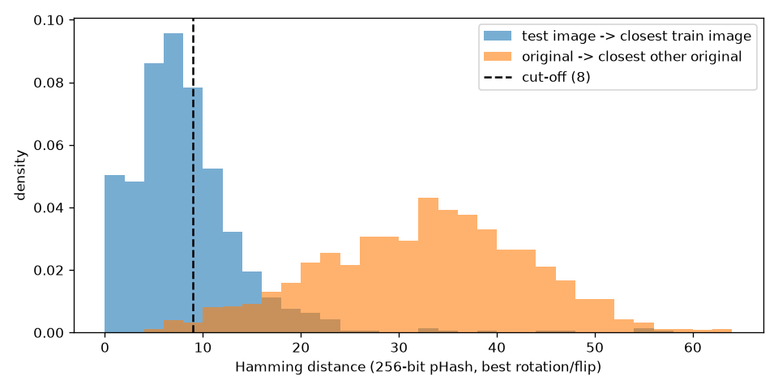
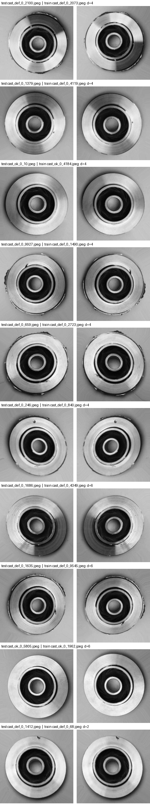
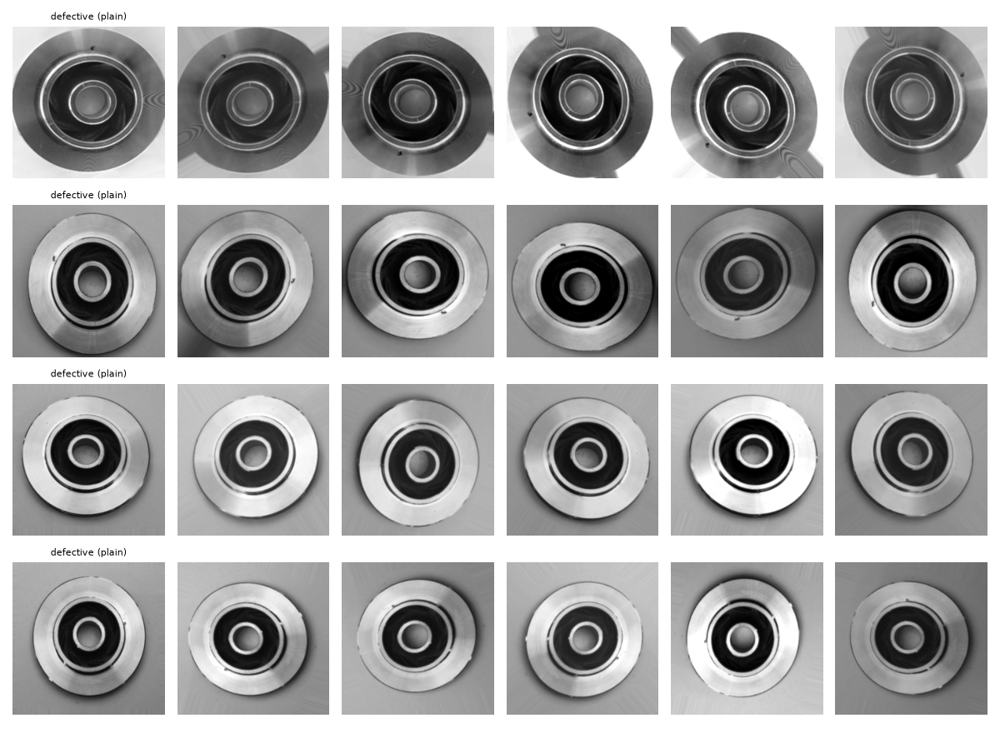
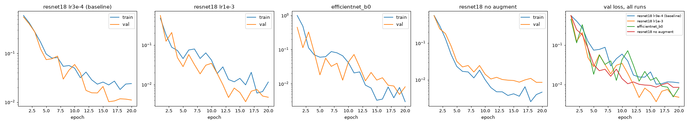
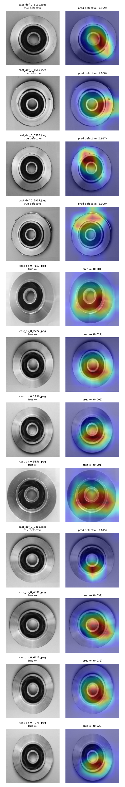
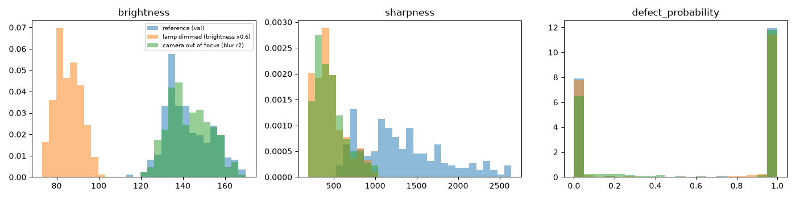

# Visual Defect Detection for Manufacturing: A Leakage-Free Baseline for Casting Inspection on CPU

**Rutvik Mendpara**

November 2026

Code: https://github.com/RutvikMendpara/Visual-defect-detection-for-manufacturing

---

## Abstract

Public datasets for industrial visual inspection often come with a ready-made train/test split, and models trained on them routinely report near-perfect accuracy. I look at one such dataset, a set of top-view photos of cast submersible pump impellers, and find that its official split is heavily contaminated. Using a rotation- and mirror-aware perceptual hash, 71.7% of the official test images have a near-copy in the training set, and even the strictest cut-off flags 36.9%. The cause is that augmentation was applied before splitting. I rebuild the split from the 1,300 un-augmented originals, keeping near-duplicate photos in the same split, and train a fine-tuned ResNet-18 as a baseline.

On the clean test set (258 images) the model catches all 156 defective parts with no false alarms on 102 good ones, at a decision threshold chosen only on validation data. Because the test set is small, I report this as a miss rate below 2.4% at 95% confidence rather than as 100% recall. Stress tests show the main weakness is lighting outside the training range, not blur or resolution, and give no sign that the model relies on the fact that defective images are darker on average. For deployment, the model is exported to ONNX and quantized to INT8. Quantization shifts the scores enough that the FP32 threshold no longer has a safe margin, so the INT8 model gets its own threshold, again chosen on validation. The final model is 11.3 MB and runs in 4.3 ms per image on a laptop CPU, including image loading. I also show that monitoring simple input statistics catches simulated lighting and focus changes that the model's own confidence does not reveal.

---

## 1. Introduction

At a casting foundry, parts are often checked by eye as they come off the line. Inspectors get tired over a shift, two people can judge the same part differently, and a part that passes in the morning might fail in the evening. A defective part that slips through reaches the customer and turns into returns, warranty claims and rework. A camera and a classifier that flags suspect parts could help, as long as it is honest about how often it misses defects and cheap enough to run on an ordinary computer next to the line.

This work started as an attempt to build that kind of classifier for the Kaggle "Real-life Industrial Dataset of Casting Product" [1]. It ended up being as much about evaluation as about modelling. The dataset is close to separable for a modern pretrained CNN, so the interesting questions are whether the reported numbers can be trusted, where the model would fail in practice, and what has to change when the model is made small enough to deploy.

The main points are:

1. **The official split leaks.** A perceptual-hash audit that accounts for arbitrary rotations and mirroring finds near-copies of 71.7% of the official test images in the training set (Section 3).
2. **A clean split and a reproducible baseline.** I rebuild train/validation/test from the un-augmented originals with near-duplicates grouped, and fine-tune ResNet-18 with a threshold chosen on validation only (Sections 4 and 5).
3. **Honest reporting of a perfect score.** Zero errors on 258 test images is reported with confidence bounds and a stress test, which shows that lighting is the real risk (Sections 6 and 7).
4. **Deployment details that change the result.** INT8 quantization needs its own validation threshold. Input statistics catch drift that output confidence misses (Section 8).

Everything runs from the command line with a fixed seed. Commands are listed in Section 11.

---

## 2. Related work

**Industrial inspection datasets.** MVTec AD [2] is the standard benchmark for unsupervised anomaly detection in manufacturing, with 15 object and texture categories. Methods such as PatchCore [3] train on good parts only and score how far a test image is from them. The casting dataset used here is different: it has defect labels, so it suits supervised classification. It is also small and comes from a single camera setup, which makes it a reasonable stand-in for what a single factory would actually have.

**Leakage and near-duplicates.** Kaufman et al. [4] describe leakage in general as information in training data that would not be available at prediction time. A specific and common form in image data is near-duplicates shared between training and test sets. Barz and Denzler [5] found such duplicates in CIFAR and showed that removing them changes how models rank. Perceptual hashes such as pHash [6] are a cheap way to find them. They are robust to small changes in pixel values but not to rotation, which matters here.

**Transfer learning and explanations.** Fine-tuning an ImageNet-pretrained network [7] such as ResNet [8] is the usual approach when only a few thousand labelled images are available. Grad-CAM [9] highlights the image regions that drove a prediction. For networks that end in global average pooling and a single linear layer, it reduces to the earlier class activation map (CAM) of Zhou et al. [10], which I use to get heatmaps without gradients at inference time.

**Quantization and shift detection.** Integer quantization [11] trades a small loss of precision for faster and smaller models. Rabanser et al. [12] study ways to detect dataset shift. Here I use a simple per-feature population stability index on logged input statistics.

---

## 3. Data and the leakage audit

### 3.1 Dataset

The dataset [1] contains top-view grayscale photos of cast pump impellers, labelled OK or defective (`def_front`), in two versions:

| Version | Images | Defective | OK | Notes |
| --- | --- | --- | --- | --- |
| 300×300, official train | 6,633 | 3,758 | 2,875 | augmented |
| 300×300, official test | 715 | 453 | 262 | augmented |
| 512×512 originals | 1,300 | 781 | 519 | not augmented |

The images are stored as RGB with three identical channels. According to the dataset page, augmentation was already applied to the 300×300 images. 1,300 originals became 7,348 images, so each physical part appears five to six times. Visible defects include flash and burrs along the outer rim, blowholes and pinholes on the flat face, cracks and chipped edges. Most of them sit on or near the rim.

Defective images are darker on average than OK ones (mean pixel value 139.3 vs 149.8 in the 300×300 set). Mean brightness alone separates the classes with ROC-AUC 0.876 on the 300×300 set and 0.801 on the originals, so a model could in principle learn darkness as a shortcut. I come back to this in Section 7.

### 3.2 Method

The audit asks a simple question: for each official test image, is there a training image that shows the same physical part?

A first attempt with a standard 64-bit pHash on whole images did not work. All impellers look alike at 8×8 DCT resolution, and unrelated parts came out at Hamming distance 0. Two changes made the hash usable:

- **A 256-bit hash** (16×16 low-frequency DCT coefficients, thresholded at their median), computed on the central 70% of a 128×128 grayscale image. The crop keeps the empty corners left by rotation out of the hash.
- **Rotation and mirror search.** Looking at matched pairs showed that the augmentation used arbitrary angles, not just multiples of 90°. Each test image is therefore hashed at every 5° of rotation, both as is and mirrored (144 hashes). Its distance to a training image is the minimum over all of them.

To pick a cut-off, I need to know how close two *different* parts can look. The 1,300 originals serve as that baseline: for each original I compute the distance to its nearest other original with the same rotation search. These distances are mostly between 20 and 50 bits. Only 1.6% of originals have a neighbour at distance 8 or below, so I use **distance ≤ 8** as the cut-off and treat 1.6% as a rough false alarm rate for the check.

### 3.3 Results

| Cut-off (bits of 256) | Official test images with a near-copy in train | Originals flagged (false alarm estimate) |
| --- | --- | --- |
| 4 | 36.9% | 0.2% |
| 8 | **71.7%** | 1.6% |
| 12 | 88.7% | 4.9% |
| 16 | 94.8% | 9.4% |

At the chosen cut-off, 513 of 715 official test images are leaked: 281 of 453 defective and 232 of 262 OK. Ten randomly chosen flagged pairs were checked by eye, and all ten show the same part (the same flash, holes and machining marks, rotated or mirrored). The real figure is probably higher than 71.7%, since pairs at distances 16 to 30 often turned out to be the same part zoomed in, and pHash does not handle scale changes well. The conclusion does not depend on the cut-off, though: even the strictest one flags more than a third of the test set.



*Figure 1. Distance from each official test image to its closest training image (blue) against the distance from each 512×512 original to its closest other original (orange). The dashed line marks the cut-off.*



*Figure 2. Ten random flagged pairs (test on the left, train on the right). All show the same physical part.*

A side observation: 37 defective test images are named `new__0_*` rather than `cast_def_0_*`, which suggests they were added separately. 28 of them have a near-copy in train, so they are also augmented versions of the same originals.

### 3.4 Rebuilt split

Any score on the official split mostly measures how well a model remembers parts it has already seen. I therefore discard it and build a new split from the 1,300 originals, one row per photo, with augmentation applied only during training.

Some originals are near-duplicates of each other too, probably the same part photographed twice. Originals within distance 8 of each other are joined into groups (15 images are affected), and every group stays in a single split. The split is 60/20/20, stratified by class, with seed 42:

| Split | Images | Defective | % defective |
| --- | --- | --- | --- |
| Train | 781 | 468 | 59.9% |
| Validation | 261 | 157 | 60.2% |
| Test | 258 | 156 | 60.5% |

Validation and test are larger than the usual 15% because the dataset is small: with 156 defective test images, one miss costs 0.6 points of recall. The split is saved as a CSV file (path, label, split, group) and committed to the repository, so every experiment uses exactly the same images. The cost is 781 training images instead of 6,633.

I did not try to map each 300×300 image back to its original and reuse the augmented set. With zoom in the augmentation the matching is unreliable, and a wrong match would reintroduce the leak.

---

## 4. Method

### 4.1 Preprocessing

Images are loaded as single-channel grayscale, resized from 512 to 224 pixels, copied into three identical channels and normalised with ImageNet statistics. The pretrained weights expect three channels in that range, and copying the channel leaves the first convolution unchanged.

### 4.2 Augmentation

Training augmentations were chosen to mimic real variation on a line without hiding or creating defects:

| Augmentation | Reason |
| --- | --- |
| Rotation by any angle | The part is round and arrives at any angle. |
| Shift up to 2% | Parts are not perfectly centred. A 4% shift pushed the rim, where most flash defects are, out of frame. |
| Horizontal flip | Not physically realistic (the vanes would curve the wrong way), but vane direction carries no label information. |
| Brightness and contrast ±20% | Lighting drifts over a shift and as lamps age. It also works against the brightness shortcut. |

Rotation leaves empty corners. Filling them with a flat colour left a visible square outline on the unevenly lit background, which only training images would have had. Instead, the image is padded by repeating its edge pixels, rotated and cropped back. Augmentations that could remove or fake a defect were left out on purpose: random erasing, blur and noise, random crops and elastic or perspective warps. Validation and test images are only resized and normalised.



*Figure 3. Each row shows one training image without augmentation (left) and five augmented versions.*

### 4.3 Model and training

The baseline is ResNet-18 [8] (`resnet18.a1_in1k` from timm [13], 11.2M parameters) with a single output logit for "defective". Training uses binary cross-entropy, AdamW [14] with learning rate 1e-3 and weight decay 1e-4, cosine learning rate decay [15] over 20 epochs and batch size 32. All random seeds are fixed at 42. Two identical runs on an Apple M4 GPU (MPS) produced identical metrics to four decimal places. An epoch takes about 13 seconds.

ResNet-18 was chosen over EfficientNet-B0 [16] for speed. EfficientNet-B0 has a third of the parameters, but in eager PyTorch on the M4 CPU it took 93 ms per image against 13 ms for ResNet-18. Its depthwise convolutions are cheap in FLOPs but slow in practice.

The checkpoint is chosen by validation PR-AUC, with validation loss as a tie-breaker. Accuracy at a 0.5 threshold was not used, because the threshold is chosen separately and accuracy mixes up the two kinds of error.

### 4.4 Threshold selection

The targets are recall of at least 99% on defective parts and a false alarm rate of at most 5% on good parts. A threshold of 0.5 says nothing about those targets, so the threshold is chosen on validation data:

1. Find every logit threshold that meets **both** targets on the validation set. This gives a range from the score above which at most 5% of OK parts are flagged up to the score below which recall stays at 99% or more.
2. Take the **middle** of that range, in logit space.

The middle leaves the most room for test scores to land a little differently from validation scores. Logit space is used because probabilities are squashed near 0 and 1, where the "middle" would not mean much. The threshold is saved with the model and applied unchanged to the test set, which is evaluated once.

---

## 5. Training experiments

Four runs, each changing one thing from the baseline:

| Run | Change | Best epoch | Val loss | Val PR-AUC | Epoch PR-AUC first hit 1.0 |
| --- | --- | --- | --- | --- | --- |
| ResNet-18, lr 3e-4 | baseline | 16 | 0.0102 | 1.000 | 12 |
| ResNet-18, lr 1e-3 | learning rate | 16 | **0.0037** | 1.000 | 12 |
| EfficientNet-B0, lr 3e-4 | model | 19 | 0.0049 | 1.000 | 5 |
| ResNet-18, lr 3e-4, no augmentation | augmentation | 19 | 0.0085 | 1.000 | 4 |



*Figure 4. Training and validation loss per run (log scale), and validation loss for all four runs together.*

The higher learning rate learned faster and reached the lowest validation loss, at the cost of a noisy early epoch. Without augmentation, training loss dropped below validation loss from epoch 5 and the gap kept growing, which is the early stage of memorisation. Validation loss never went back up in 20 epochs, so no run overfitted badly. With augmentation, training loss stays above validation loss, which is expected because the training images are made harder.

The main finding is that **the validation set saturates.** Every run separates all 261 validation images perfectly, so PR-AUC cannot tell runs or epochs apart, and only validation loss (how confident the model is) still moves. With one seed per run, the differences between runs could be noise. I selected ResNet-18 at learning rate 1e-3, but the honest conclusion is that on clean, evenly lit data this task is easy for a pretrained CNN, and harder questions come later.

---

## 6. Test results

On validation, the highest OK score is 0.039 and the lowest defective score is 0.647, so the classes are fully separated. The valid threshold range is logit -5.33 to 1.92, and its middle, logit -1.70, gives a threshold of **0.154**.

On the test set, at that threshold:

| | Predicted OK | Predicted defective |
| --- | --- | --- |
| Actually OK | 102 | 0 |
| Actually defective | 0 | 156 |

| Metric | Target | Result |
| --- | --- | --- |
| Recall (defective) | ≥ 99% | 100% (156/156) |
| False alarm rate | ≤ 5% | 0% (0/102) |
| Precision | | 100% |
| F1 | | 1.000 |
| ROC-AUC | ≥ 0.99 | 1.000 |
| CPU latency, PyTorch FP32 | median < 50 ms | 11.6 ms (p95 12.4 ms) |

Latency is measured on an Apple M4 CPU with batch size 1, including reading the file and preprocessing, after 10 warm-up runs and over 500 timed runs.

A perfect score on 258 images is not the same as a perfect model. Using the Wilson score interval [17], 0 misses out of 156 is consistent with a true miss rate of up to **2.4%** at 95% confidence, and 0 false alarms out of 102 with a false alarm rate of up to **3.6%**. To show 99% recall with confidence would take several hundred more defective test images.

In practical terms, assuming a line where 5% of parts are defective (an assumption, not a measurement), 1,000 parts contain 50 defective ones. The measured result is zero missed and zero good parts sent for a second look. The worst case within the bounds is about one missed defect and about 34 good parts re-checked per 1,000.

---

## 7. Error analysis and robustness

With no test errors to study, I looked at the closest calls on test and stress-tested on validation.

### 7.1 Closest calls

The only defective test image near the threshold scored 0.615. At full 512×512 resolution I could not find a visible defect in it. Grad-CAM points at the bottom of the hub, so it is either a very small defect or a labelling mistake. The highest-scoring OK images (0.02 to 0.04) are still far below the threshold. One of them has a small dark dot on the rim that looks like a pinhole, which probably explains its score.

### 7.2 Stress test

Validation images were altered before preprocessing, with the same threshold:

| Change | Missed defects (of 157) | Good parts flagged (of 104) |
| --- | --- | --- |
| none | 0 | 0 |
| brightness ×0.6 | 1 | 0 |
| brightness ×0.8 or ×1.2 | 0 | 0 |
| brightness ×1.4 | 2 | 0 |
| contrast ×0.6 | 2 | 0 |
| contrast ×1.4 | 0 | 4 |
| Gaussian blur, radius 1 / 2 | 0 | 0 / 1 |
| downscaled to 128 px and back | 0 | 0 |

Three kinds of weakness show up: lighting outside the ±20% training range (the largest), tiny or unclear defects, and defect-like marks on good parts. Blur and lower resolution barely matter.

The stress test also addresses the brightness shortcut from Section 3.1. If the model had learned "dark means defective", darkening images would cause false alarms. Instead it causes one missed defect and no false alarms, so there is no sign the model relies on overall brightness.

### 7.3 Grad-CAM



*Figure 5. Grad-CAM for four random defective and four random OK test images, followed by the closest calls. For OK predictions the map explains the OK decision (negative logit).*

For defective predictions the heatmaps highlight specific spots on the rim and outer edge, different for each part, which is where flash and blowholes appear. For OK predictions they mostly highlight the hub and inner ring, which is the model saying "this area looks normal". That is a weaker explanation, since the absence of a defect has no single location. None of the heatmaps focus on the background or the image corners, which was a concern after the edge-padding augmentation. The maps are 7×7 upsampled, so they show regions, not pixels.

### 7.4 A fix that did not help

The obvious fix for lighting sensitivity is wider brightness and contrast jitter. Training with ±40% instead of ±20% (judged on validation only) made the model more stable under brightness changes, but worse on normal images: one miss and one false alarm on clean validation instead of none, validation loss 0.017 instead of 0.004, and seven good parts flagged under blur radius 2 instead of one. On a line with fixed lighting this is a bad trade, so I kept the ±20% model and never ran the alternative on test. In practice, checking the lighting at the camera is probably cheaper than making the model handle every condition, and Section 8.4 does exactly that.

---

## 8. Deployment

### 8.1 ONNX export and INT8 quantization

The model is exported to ONNX with two outputs: the logit and a 7×7 class activation map. For a network that ends in global average pooling and one linear layer, the Grad-CAM weights are just the linear layer's weights, so applying them at every location gives the same map [10] without needing gradients at inference time. On 64 test images, PyTorch and ONNX Runtime differ by at most 1.6e-5 in the logit, with identical decisions.

The INT8 model uses static quantization with per-channel weights, calibrated on 200 training images. Dynamic quantization would only affect the final linear layer, while almost all the time is spent in convolutions.

**Quantization moved the scores enough to matter.** On validation, the highest OK score went from logit -3.21 to -1.66, crossing the FP32 threshold of -1.70 and producing a false alarm. On test, the closest OK image ended up at -1.77, just 0.07 below that threshold. The test result was only clean by luck. The INT8 model is effectively a different model, so I chose its threshold on validation again with the same rule. The valid range became -3.88 to 3.33, giving a threshold of 0.431 and about 1.5 logits of margin on both sides on test.

### 8.2 Speed and size

Apple M4 CPU, ONNX Runtime 1.31, PyTorch 2.15, batch size 1, file read and preprocessing included, 10 warm-up runs and 500 timed runs. Each version uses its own validation threshold.

| Version | Recall | False alarms | 1 thread median / p95 | 4 threads median / p95 | 4 threads img/s | Size |
| --- | --- | --- | --- | --- | --- | --- |
| PyTorch FP32 | 156/156 | 0/102 | 15.9 / 16.6 ms | 11.7 / 12.9 ms | 85 | 44.8 MB |
| ONNX FP32 | 156/156 | 0/102 | 18.3 / 18.7 ms | 9.5 / 10.1 ms | 105 | 44.8 MB |
| ONNX INT8 | 156/156 | 0/102 | 10.3 / 10.5 ms | 4.3 / 4.8 ms | 228 | 11.3 MB |

INT8 is about 2.7 times faster than PyTorch on four threads and four times smaller, with identical test decisions. On a single core it handles about 97 images per second, roughly 5,800 parts per minute, which is far more than a casting line produces. The trade-off is slightly worse robustness to blur (Section 8.4) and the need for a separate threshold.

### 8.3 Service

The INT8 model is served with FastAPI in a Docker image based on `python:3.13-slim`. The image contains only the inference code, ONNX Runtime, NumPy and Pillow, with no PyTorch, and is 459 MB on disk. The service exposes `/health`, `/predict` and `/predict/heatmap`, rejects bad input with clear 4xx errors and logs every prediction as one JSON line. Over 300 sequential requests to the container, the median end-to-end time is 7.9 ms (p95 8.6 ms), of which 3.9 ms is preprocessing and the model. The rest is HTTP, upload parsing, JPEG decoding and JSON.

### 8.4 Monitoring

Every prediction also logs three cheap statistics of the input image: mean brightness, contrast (standard deviation) and sharpness (variance of the Laplacian). A recent window of logs is compared with a reference taken from the validation set, using the population stability index (PSI) per feature. Below 0.1 is treated as stable and above 0.25 as drifted.

I simulated three changes on the test set:

| Scenario | Brightness PSI | Sharpness PSI | Output probability PSI | Missed | False alarms |
| --- | --- | --- | --- | --- | --- |
| No change | 0.10 | 0.04 | 0.08 | 0/156 | 0/102 |
| Lamp dimmed (×0.6) | **8.29** | **6.62** | 0.17 | 2/156 | 0/102 |
| Camera out of focus (blur r2) | 0.10 | **6.21** | **0.33** | 3/156 | 4/102 |
| Slow lamp drift (×0.85) | **4.66** | **1.42** | 0.08 | 0/156 | 0/102 |



*Figure 6. Brightness, sharpness and output probability for the validation reference and two simulated changes.*

All three changes are flagged. The slow lamp drift causes no errors yet but already shows up in brightness, which is the early warning a factory would want. The model's output distribution barely moves in any scenario: it stays confident even when it starts making mistakes. Monitoring only the predictions would have missed the dimmed lamp entirely, while monitoring the inputs catches it immediately. Sharpness is not independent of brightness, since a darker image has smaller pixel differences, so a dim lamp shows up in both.

---

## 9. Limitations

- **One camera, one lighting setup.** All images come from a single setup. A different camera, lighting or product would need new images, a new threshold and probably retraining.
- **Small test set.** Zero errors on 258 images bounds the miss rate below 2.4%, which is not enough to claim 99% recall.
- **Saturated validation set.** Once every run separates validation perfectly, model selection relies on validation loss, which is a weak signal. Several seeds per configuration would be needed to rank runs properly.
- **Imperfect leakage audit.** pHash does not handle scale changes, so the 71.7% figure is likely an underestimate. A learned image embedding would match zoomed copies better.
- **Class balance.** The data is about 60% defective. A real line has far fewer defects, which would lower precision even at the same false alarm rate.
- **Possible label noise.** At least one defective image shows no visible defect.
- **Monitoring cannot measure accuracy.** Input statistics show that conditions changed, not whether predictions are still right. That needs reviewed feedback from the line.
- **Licence.** The dataset is CC BY-NC-ND 4.0, so this work is for learning and non-commercial use.

---

## 10. Conclusion

On this dataset, the hard part was not getting a high score but making sure the score meant something. The official split overstates performance because most test images are rotated or mirrored copies of training images. On a clean split, a fine-tuned ResNet-18 still separates the classes perfectly, which says more about how controlled the imaging conditions are than about the model. The useful work was around the model: choosing the threshold on validation from the actual targets, reporting a perfect test score with its uncertainty, finding that lighting is the real risk, noticing that INT8 quantization quietly broke the threshold margin, and showing that input statistics catch drift that the model's confidence hides.

The next steps are anomaly detection trained on good parts only (PatchCore [3]), which would not need defect labels for a new product, and an evaluation on MVTec AD [2] to see how much of this carries over to other parts and materials.

---

## 11. Reproducibility

Everything uses seed 42 and runs from the command line with uv. The dataset has to be downloaded from Kaggle into `data/raw/`.

```bash
uv sync
uv run python -m defect_detection.leakage
uv run python -m defect_detection.data split
uv run python -m defect_detection.train --model resnet18 --lr 1e-3 --epochs 20
uv run python -m defect_detection.evaluate threshold --run models/resnet18-lr0.001
uv run python -m defect_detection.evaluate test      --run models/resnet18-lr0.001
uv run python -m defect_detection.export onnx        --run models/resnet18-lr0.001
uv run python -m defect_detection.export quantize    --run models/resnet18-lr0.001
uv run python -m defect_detection.export bench       --run models/resnet18-lr0.001
uv run python -m defect_detection.monitor simulate
uv run pytest
```

Hardware: Apple M4 (training on MPS, all latency on CPU). Software: Python 3.13, PyTorch 2.15, timm 1.0.30, ONNX Runtime 1.31. The split file `data/splits.csv` is in the repository. Training runs are logged with MLflow. More detail is in `DATA.md`, `reports/experiments.md`, `reports/evaluation.md` and `reports/deployment.md`.

---

## References

[1] ravirajsinh45. *Real-life Industrial Dataset of Casting Product.* Kaggle, 2020. https://www.kaggle.com/datasets/ravirajsinh45/real-life-industrial-dataset-of-casting-product

[2] P. Bergmann, M. Fauser, D. Sattlegger, C. Steger. *MVTec AD: A Comprehensive Real-World Dataset for Unsupervised Anomaly Detection.* CVPR, 2019.

[3] K. Roth, L. Pemula, J. Zepeda, B. Schölkopf, T. Brox, P. Gehler. *Towards Total Recall in Industrial Anomaly Detection.* CVPR, 2022.

[4] S. Kaufman, S. Rosset, C. Perlich, O. Stitelman. *Leakage in Data Mining: Formulation, Detection, and Avoidance.* ACM Transactions on Knowledge Discovery from Data, 2012.

[5] B. Barz, J. Denzler. *Do We Train on Test Data? Purging CIFAR of Near-Duplicates.* Journal of Imaging, 2020.

[6] C. Zauner. *Implementation and Benchmarking of Perceptual Image Hash Functions.* Master's thesis, Upper Austria University of Applied Sciences, 2010.

[7] J. Deng, W. Dong, R. Socher, L.-J. Li, K. Li, L. Fei-Fei. *ImageNet: A Large-Scale Hierarchical Image Database.* CVPR, 2009.

[8] K. He, X. Zhang, S. Ren, J. Sun. *Deep Residual Learning for Image Recognition.* CVPR, 2016.

[9] R. R. Selvaraju, M. Cogswell, A. Das, R. Vedantam, D. Parikh, D. Batra. *Grad-CAM: Visual Explanations from Deep Networks via Gradient-based Localization.* ICCV, 2017.

[10] B. Zhou, A. Khosla, A. Lapedriza, A. Oliva, A. Torralba. *Learning Deep Features for Discriminative Localization.* CVPR, 2016.

[11] B. Jacob, S. Kligys, B. Chen, M. Zhu, M. Tang, A. Howard, H. Adam, D. Kalenichenko. *Quantization and Training of Neural Networks for Efficient Integer-Arithmetic-Only Inference.* CVPR, 2018.

[12] S. Rabanser, S. Günnemann, Z. C. Lipton. *Failing Loudly: An Empirical Study of Methods for Detecting Dataset Shift.* NeurIPS, 2019.

[13] R. Wightman. *PyTorch Image Models.* GitHub, 2019. https://github.com/huggingface/pytorch-image-models

[14] I. Loshchilov, F. Hutter. *Decoupled Weight Decay Regularization.* ICLR, 2019.

[15] I. Loshchilov, F. Hutter. *SGDR: Stochastic Gradient Descent with Warm Restarts.* ICLR, 2017.

[16] M. Tan, Q. V. Le. *EfficientNet: Rethinking Model Scaling for Convolutional Neural Networks.* ICML, 2019.

[17] E. B. Wilson. *Probable Inference, the Law of Succession, and Statistical Inference.* Journal of the American Statistical Association, 1927.
