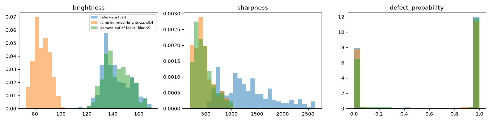

# Deployment

## ONNX export and INT8

```
uv run python -m defect_detection.export onnx     --run models/resnet18-lr0.001   # export + check vs PyTorch
uv run python -m defect_detection.export quantize --run models/resnet18-lr0.001   # INT8 + its own val threshold
uv run python -m defect_detection.export bench    --run models/resnet18-lr0.001   # writes reports/benchmark.md
uv run python -m defect_detection.export deploy   --run models/resnet18-lr0.001 --file model.int8.onnx
```

ONNX is a file format for the model graph plus weights. ONNX Runtime runs it without PyTorch, and it can fuse layers and pick faster CPU kernels than PyTorch's eager mode. It also means the API image doesn't need torch at all.

The exported graph has two outputs: the logit and a 7×7 class activation map. The head is average pooling + one linear layer, so the Grad-CAM weights are just the linear weights, and the heatmap works without gradients.

**Export check:** 64 test images through PyTorch and ONNX Runtime. Max logit difference 1.6e-5, same decision on all of them.

**INT8:** static quantization, per-channel weights, calibrated on 200 train images (not val or test). Dynamic quantization would only touch the final linear layer, almost all the time is in the convolutions.

INT8 moved the scores. On val the highest OK score went from logit -3.21 to -1.66, which crosses the FP32 threshold (-1.70) and gave a false alarm. On test the closest OK part ended up 0.07 below that threshold, so it only looked fine by luck. The INT8 model is a different model, so it gets its own threshold, chosen on val with the same rule as before (middle of the range that meets both targets). That puts it at 0.431, with about 1.5 logits of room on both sides on test.

## Results

Apple M4, onnxruntime 1.31.1, torch 2.15. Batch 1, file read + preprocessing + model, 10 warm-up runs, 500 timed. Metrics on the test split, each version with its own val threshold.

| Version | Recall | Precision | False alarms | 1 thread median / p95 | 1 thread img/s | 4 threads median / p95 | 4 threads img/s | File size |
| --- | --- | --- | --- | --- | --- | --- | --- | --- |
| PyTorch FP32 | 1.000 (156/156) | 1.000 | 0/102 | 15.9 / 16.6 ms | 63 | 11.7 / 12.9 ms | 85 | 44.8 MB |
| ONNX FP32 | 1.000 (156/156) | 1.000 | 0/102 | 18.3 / 18.7 ms | 55 | 9.5 / 10.1 ms | 105 | 44.8 MB |
| ONNX INT8 | 1.000 (156/156) | 1.000 | 0/102 | 10.3 / 10.5 ms | 97 | 4.3 / 4.8 ms | 228 | 11.3 MB |

Full output in `benchmark.md`. Skipped OpenVINO, it's tuned for Intel CPUs and wouldn't show much on an M4.

Notes:

- ONNX FP32 is slower than PyTorch on 1 thread here but faster on 4. PyTorch on Apple Silicon has well-tuned single-thread kernels.
- INT8 roughly halves latency on both thread counts and is 4x smaller.
- The model is not the bottleneck anywhere near 50 ms. Reading the JPEG and resizing is a few ms of every number above.

**Deploying: ONNX INT8**, because it's 2.7x faster than PyTorch on 4 threads and 4x smaller with the same test results, as long as it keeps its own threshold chosen on val, since quantization shifts the scores.

The trade-off: INT8 is a bit less robust to blur than FP32 (see monitoring below), and the test set is too small to show a recall difference under 2-3%. If the line ever runs on a machine where 10 ms vs 4 ms doesn't matter, FP32 is the safer pick.

## API

```
uv run uvicorn app.main:app --port 8000      # local, docs at http://localhost:8000/docs
docker build -t casting-inspection .
docker run --rm -p 8000:8000 casting-inspection
```

| Endpoint | Returns |
| --- | --- |
| `GET /health` | `status`, `model`, `threshold`. 503 if the model isn't loaded |
| `POST /predict` (file) | `label`, `defect_probability`, `threshold`, `model`, `latency_ms` |
| `POST /predict/heatmap` (file) | same plus `heatmap_png` (base64) |

Bad input: wrong content type → 415, empty/corrupt/truncated image → 400, over 10 MB → 413, no file → 422. Images over 40 megapixels are refused to avoid decompression bombs.

Each prediction is logged as one JSON line: timestamp, endpoint, file name, label, probability, model time, total time, and brightness/contrast/sharpness of the input. Set `LOG_FILE` to also append them to a file for monitoring.

The Docker image is `python:3.13-slim` with only fastapi, uvicorn, onnxruntime, numpy and Pillow, no torch. 459 MB on disk, runs as a non-root user, has a health check.

## End-to-end latency

300 sequential requests from the host to the container, 10 warm-up (`uv run python app/bench_api.py`):

| | median | p95 |
| --- | --- | --- |
| End to end through the API | 7.9 ms | 8.6 ms |
| Model part (preprocess + ONNX, reported by the API) | 3.9 ms | 4.2 ms |
| Overhead | 4.0 ms | |

The overhead is the HTTP round trip, uploading the file, multipart parsing, decoding the JPEG, JSON and logging. About half the total. Still far under 50 ms.

## Parts per minute

On one M4 core the INT8 model does about 97 images/s, so roughly **5,800 parts per minute**. Through the API, one request at a time, about 7,600 per minute. A casting line moves maybe tens of parts per minute, so even a CPU 20x slower than this one (an old office PC or a small ARM board) would keep up. The camera and the conveyor set the speed, not the model.

## Monitoring

```
uv run python -m defect_detection.monitor reference    # stats from val, saved next to the deployed model
uv run python -m defect_detection.monitor check --log logs/predictions.jsonl
uv run python -m defect_detection.monitor simulate
```

Every prediction logs the defect probability and three cheap input stats: brightness, contrast and sharpness (variance of the Laplacian). `check` compares the last 200 predictions to the val reference with the population stability index (PSI: under 0.1 stable, over 0.25 drifted).

Simulated on the test set (`monitoring.txt`):

| Scenario | Brightness PSI | Sharpness PSI | Probability PSI | Missed | False alarms |
| --- | --- | --- | --- | --- | --- |
| normal | 0.10 | 0.04 | 0.08 | 0/156 | 0/102 |
| lamp dimmed (×0.6) | **8.29** | **6.62** | 0.17 | 2/156 | 0/102 |
| camera out of focus (blur r2) | 0.10 | **6.21** | **0.33** | 3/156 | 4/102 |
| slow lamp drift (×0.85) | **4.66** | **1.42** | 0.08 | 0/156 | 0/102 |



- Every change gets flagged. The slow lamp drift doesn't cause any errors yet, but brightness already shows it. That's the early warning you want.
- The output distribution barely moves, the model stays confident even when it starts getting things wrong. Watching only the predictions would have missed the dimmed lamp completely. Watching the inputs catches it.
- Sharpness isn't independent of brightness (a darker image has smaller pixel differences), so a dim lamp shows up in both.

## Demo

`uv run python app/demo.py`, then http://localhost:7860.

- **Inspect:** upload a photo (or use the phone camera), see the verdict, probability and heatmap side by side. 8 sample images to click on.
- **Conveyor:** streams 20 test-split images one by one with running OK/defective counts and parts per minute.
- **Flag as wrong:** saves the image and the corrected label to `feedback/` with a JSON line, for review before the next training round.

Every prediction is logged to `logs/predictions.jsonl`, which `monitor check` reads.

For Hugging Face Spaces: `scripts/build_space.sh` puts together `build/space/` (app, inference code, INT8 model, examples, requirements, Space README). Then `uvx hf auth login` and `uvx hf upload <username>/casting-defect-inspection build/space . --repo-type space`. On a free Space the logs and feedback folder are wiped on restart, so for real use they'd need to go to a dataset repo or a database.

## Tests and CI

`uv run pytest` runs 19 tests in a few seconds. They don't need the dataset images or trained weights (only `data/splits.csv`), CI builds a small untrained model with the same export code.

- Preprocessing: numpy version used in production matches the torchvision one used in training, grayscale becomes 3 identical channels, train augmentation keeps the shape and is random, rotation leaves no black corners.
- Splits: no group shows up in two splits, classes are balanced across splits.
- Model: ONNX matches PyTorch, prediction format and probability range, any image size/mode works.
- API: health, response format, heatmap is a real PNG, wrong type / corrupt / empty / truncated / too large / missing file all get clear errors.
- Monitoring: PSI ignores noise and flags a real shift.

GitHub Actions (`.github/workflows/tests.yml`) runs them on every push. Torch on Linux comes from the CPU-only index (`[tool.uv.sources]` in pyproject.toml), otherwise CI downloads several GB of CUDA libraries for nothing.
