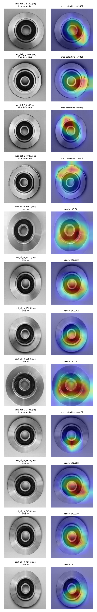

# Evaluation

Model: `models/resnet18-lr0.001/best.pt` (see experiments.md). Test set: 258 images (156 defective, 102 OK) from `data/splits.csv`, never used for training, model choice or threshold.

```
uv run python -m defect_detection.evaluate threshold --run models/resnet18-lr0.001
uv run python -m defect_detection.evaluate test      --run models/resnet18-lr0.001
uv run python -m defect_detection.evaluate latency   --run models/resnet18-lr0.001
uv run python -m defect_detection.evaluate gradcam   --run models/resnet18-lr0.001
```

## Threshold

0.5 is just where the sigmoid crosses the middle. It says nothing about what a missed defect costs compared to a false alarm, so I picked it from the targets instead.

On val the model separates the classes completely: the highest OK score is 0.039 and the lowest defective score is 0.647. Every threshold from logit -5.33 to 1.92 meets both targets on val (recall ≥ 99%, false alarms ≤ 5%). I took the middle of that range, logit -1.70 = **prob 0.154**, so there's room on both sides for test scores that land a bit differently. Done in logit space because probabilities are squashed near 0 and 1 and the "middle" there would be meaningless.

Saved in `models/resnet18-lr0.001/threshold.json` and used unchanged on test. The test command refuses to run a second time unless you pass `--again`. I reran it once only to add the confidence bounds below, same model and threshold, so the numbers didn't change.

## Test results

| Metric | Target | Result |
| --- | --- | --- |
| Recall (defective) | ≥ 99% | 100% (156/156) |
| False alarm rate | ≤ 5% | 0% (0/102) |
| Precision | | 100% |
| F1 | | 1.000 |
| ROC-AUC | ≥ 0.99 | 1.000 |
| CPU latency, median | < 50 ms | 11.6 ms |
| CPU latency, p95 | | 12.4 ms |

Confusion matrix:

| | predicted OK | predicted defective |
| --- | --- | --- |
| actually OK | 102 | 0 |
| actually defective | 0 | 156 |

Latency: Apple M4 CPU, PyTorch 2.15 eager, 4 threads, batch 1, file read + preprocessing + model, 10 warm-up runs then 500 timed. ONNX comes later.

### What 0 errors actually means

0 out of 156 doesn't mean the model never misses. With this few images the 95% upper bound on the miss rate is **2.4%**, and on the false alarm rate **3.6%** (Wilson interval). So the honest claim is "probably under 2.4% missed", not "100%". To show 99% recall with any confidence I'd need a few hundred more defective test images.

### Per 1000 parts

The test set is 60% defective, a real line is much lower. Assuming 5% defective (a guess, I don't have the real number):

- 50 parts are defective, 950 are fine.
- Measured: 0 defects slip through, 0 good parts get re-checked.
- Worst case within the 95% bounds: about 1 defect slips through and about 34 good parts get sent for a second look.

## Error analysis

No test image was misclassified, so there was nothing to list in `test_predictions.csv` (the file has every prediction with a `correct` column). Instead I looked at the closest calls and stress-tested on val to find where it breaks.

**Closest calls on test:**

- `cast_def_0_2483` (defective, 0.615). The only defect anywhere near the threshold. I can't see a defect even at full 512 px. Grad-CAM points at the bottom of the hub. Either a very small defect or a wrong label, I can't tell from the photo.
- `cast_ok_0_6418`, `4930`, `7076` (OK, 0.02-0.04). Highest OK scores, still far below the threshold. 6418 has a small dark dot on the rim that looks like a pinhole, which is probably why.

**Stress test on val** (same threshold, images changed before preprocessing):

| Change | Missed defects (of 157) | Good parts flagged (of 104) |
| --- | --- | --- |
| none | 0 | 0 |
| brightness ×0.6 | 1 | 0 |
| brightness ×0.8 / ×1.2 | 0 | 0 |
| brightness ×1.4 | 2 | 0 |
| contrast ×0.6 | 2 | 0 |
| contrast ×1.4 | 0 | 4 |
| blur radius 1 / 2 | 0 | 0 / 1 |
| low resolution (128 px) | 0 | 0 |

Error types:

1. **Lighting outside the training range.** The biggest one. Training used ±20% brightness/contrast. Beyond that, washed-out or flat images hide defects, and extra contrast makes normal texture look like defects.
2. **Tiny or unclear defects.** `cast_def_0_2483`. Might also be a labelling issue.
3. **Defect-like marks on good parts.** Small dark spots on the rim push OK scores up.

Blur and lower resolution barely matter, so camera focus isn't a big risk.

**Brightness shortcut:** DATA.md flagged that defective images are darker on average. If the model had learned "dark = defective", darkening images would cause false alarms. It does the opposite, darker images cause a missed defect and no false alarms. So no sign it's using overall brightness as a shortcut.

## Grad-CAM

Grad-CAM takes the gradient of the prediction with respect to the last conv layer's feature maps, uses it to weight those maps, and upsamples the result to a heatmap. For OK predictions I explain the OK decision (negative logit) instead of the defective score.



- Correct defective predictions light up specific spots on the rim and outer edge, different for each part, which is where flash and blowholes show up. It's looking at the part, not the background or the image corners.
- Correct OK predictions mostly light up the centre hub and inner ring. That's the model saying "this area looks normal". Less useful as an explanation, the absence of a defect has no single location.
- The heatmap is 7×7 upsampled, so it shows the region, not the exact pixel. Fine for "is it looking at the part", not for pinpointing a pinhole.

None of the heatmaps sit on the background or the image edges, which is what I was worried about after the augmentation padding.

## Trying a fix

Ideas for the lighting problem:

1. Wider brightness/contrast jitter in training (±40% instead of ±20%).
2. Normalise each image's brightness before the model (e.g. histogram equalisation), so lighting matters less in the first place.
3. Fix it on the line: a lighting check that rejects photos that are too dark/bright before they reach the model.

Tried 1 (`--jitter 0.4`, everything else the same, `models/resnet18-lr0.001-jitter0.4`), judged on val only:

- Brightness changes now barely move it (1 miss and 0-1 false alarms everywhere instead of 0-2 misses).
- But it's worse on normal images: 1 miss and 1 false alarm on clean val (was 0 and 0), val loss 0.017 vs 0.004, and blur radius 2 now flags 7 good parts instead of 1.

It traded clean accuracy for robustness to lighting changes that might never happen on a line with fixed lights. **Kept the ±20% model.** It wasn't run on test, since it was rejected on val. Idea 3 is probably the better fix in practice, it's cheaper to check the lighting than to make the model handle everything.
