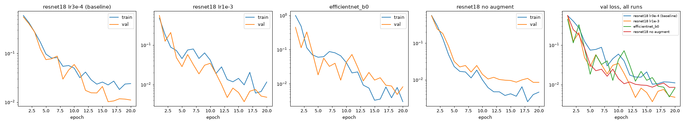

# Experiments

All runs: split `data/splits.csv` (md5 `c81cb281...`), seed 42, 20 epochs, batch 32, 224×224, trained on a MacBook M4 (mps). Logged to MLflow, experiment `casting-defects`.

Train from scratch with one command:

```
uv run python -m defect_detection.train --model resnet18 --lr 1e-3 --epochs 20
```

Checkpoint, config, per-epoch history and curves end up in `models/<run name>/`.

## Setup choices

**Model: ResNet-18 (`resnet18.a1_in1k`) as the baseline.** 11M params, about 13 ms per image on CPU in plain PyTorch, so it should fit the 50 ms target with room to spare. EfficientNet-B0 has a third of the params and is better on ImageNet, but it ran at about 93 ms per image on CPU here. Depthwise convs are cheap in FLOPs but slow in practice. Tried it anyway as one of the runs.

**Loss: binary cross-entropy on a single logit.** It's a yes/no problem and the output is a probability I can threshold later. No class weighting, the split is 60/40 so the imbalance is mild, and the recall target is handled by picking the threshold on val, not by the loss.

**Optimizer: AdamW, cosine LR decay, weight decay 1e-4.** AdamW is the usual default for fine-tuning and doesn't need much tuning. Cosine decay lets it take bigger steps early and settle at the end.

**Checkpoint: best val PR-AUC, val loss as tie-breaker.** Not accuracy, because accuracy at 0.5 mixes up the two error types and depends on the class balance. What matters is ranking defective parts above OK ones, since the threshold gets moved later to hit 99% recall. PR-AUC measures that ranking and focuses on the defective class. In practice val PR-AUC hit 1.0 in every run, so val loss ended up making the choice (see below).

## Runs

| Run | Changed | Best epoch | Val loss | Val PR-AUC | Recall @ 5% false alarms | s/epoch |
| --- | --- | --- | --- | --- | --- | --- |
| resnet18-lr0.0003 | baseline | 16 | 0.0102 | 1.000 | 1.000 | ~14 |
| resnet18-lr0.001 | learning rate | 16 | **0.0037** | 1.000 | 1.000 | ~13 |
| efficientnet_b0-lr0.0003 | model | 19 | 0.0049 | 1.000 | 1.000 | ~19 |
| resnet18-lr0.0003-noaug | no augmentation | 19 | 0.0085 | 1.000 | 1.000 | ~12 |

Current best: `models/resnet18-lr0.001/best.pt`.



### What each run taught me

- **Baseline.** Works, and is slow but steady. PR-AUC got to 1.0 at epoch 12. Train loss sits above val loss the whole time. That's not a bug, the training images are augmented (rotated, jittered) and val images aren't, so training is the harder test.
- **lr 1e-3.** Learns faster and ends at the lowest val loss. Noisier on the way: at epoch 3 recall at 0.5 dropped to 0.85 for one epoch and came back. With cosine decay the noise settles by the end.
- **EfficientNet-B0.** Hit PR-AUC 1.0 first (epoch 5), but the val loss jumps around more and it's slower to train and much slower on CPU. Not worth it for this problem unless ResNet-18 runs out of room.
- **No augmentation.** Converges fastest. From epoch 5 train loss drops below val loss and the gap keeps growing (0.004 vs 0.009 at the end). It's memorising the training images. Val loss doesn't go up within 20 epochs, so it's not hurting yet, but it plateaus higher than the augmented lr 1e-3 run. Augmentation is doing its job.

### Over/underfitting

- No underfitting, every run gets val loss near 0.01 or below.
- No run shows val loss going back up, so no harmful overfitting in 20 epochs. The no-augment run is the only one with the classic widening train/val gap.

### The real problem: val is saturated

Every run separates all 261 val images perfectly. That means:

- PR-AUC can't tell runs or epochs apart anymore. Only val loss (how *confident* the model is) still moves.
- One mistake on val is worth 0.6% recall (157 defective images), so "100% recall" here doesn't prove 99% on the line.
- The differences between runs are small, and with one seed each they could be noise. To really compare I'd need several seeds, or a harder eval set.

The task looks easy on clean data with fixed lighting. The harder questions are now about threshold margins, the test set and how robust it is to changes in lighting or camera, not about squeezing out more val PR-AUC.
